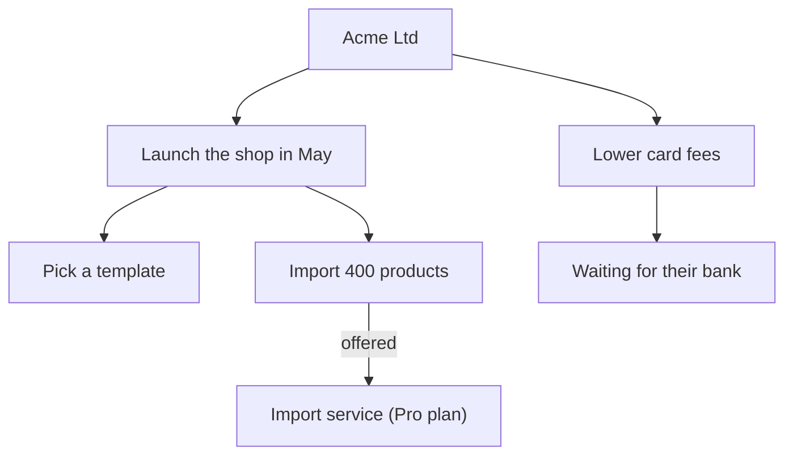

# The client map (P135)

One Mermaid diagram per client: the top-level picture of what the client wants, what is still open and what we did. The agent
redraws it after each draft (Mail or a messenger); the Hub keeps it, shows it, and copies it to the client's Notion page.

## Where it lives

- **The Hub is the truth.** `clients.map` holds the current Mermaid text, `clients.map_updated_at` when it was drawn, and
  `client_maps` every version (migration 0036), so a redraw never loses the previous map. Only a client the Hub recorded (after a
  draft, a kept message or a linked chat) has a map: the database is not a client directory (decision 0009).
- **Who writes it:** the agent, through the hub MCP tool `client_map` (the whole new text, with the client's id or address), after
  a draft. It reads the current map with `client_show`. Writing a map sends nothing.
- **Where the owner sees it:** Mail and Messengers, the conversation header's **Map** button opens a wide side sheet: the drawing,
  "Updated <when>", the previous version on a toggle, and the same map as an outline (the states in words). No map yet: "No map
  yet: the agent draws one with the next reply." A lead's card has none: a lead has no map until it is a client.
- **Notion:** the client's Clients page gets one section, a heading "Client map" and one `mermaid` code block under it, which
  the Hub updates in place on every new version (the rest of the page is never touched; the integration cannot delete, so the
  block is edited, not replaced). The date property **Map updated** lets a view sort by it. There is no text property for the
  source (2,000 UTF-16 units per rich text item, and Notion would show raw code); the code block is split into items of at most
  2,000 units. `hub install` adds **Map updated** (step `notion.client-map`); Notion's API cannot create a Status or a
  cross-database formula, and this needs neither.

## The shape (what `client_map` accepts)

`@hub/diagram/map` checks the text before it is saved; a refusal (`map_invalid`) names the line and the old map stays. It is a
strict subset of Mermaid's flowchart (Mermaid's own parser needs a DOM and cannot run on the server; `@mermaid-js/parser` has no
flowchart grammar), so what passes is valid Mermaid:

- `flowchart TD` first. Nodes `id[Label]`, `id(Label)`, `id{Label}`, `id([Label])`, `id((Label))`, `id[[Label]]`; a label with
  brackets in quotes (`id["Import (Pro plan)"]`). Edges `a --> b`, `a -.-> b`, `a ==> b`, `a -->|offered| b`. `subgraph id[Label]`
  ... `end` (no nesting). `class a,b done` or `id[...]:::done`. `%%` comments. Nothing else: no `classDef`, `style`, `click`.
- **Root:** the client (company), the one node nothing points at. **Level 1:** their goals or problems, at most 6 open (a branch
  marked `done` does not count). **Below:** sub-problems or questions, at most 4 levels below the client. **Leaves:** what we did
  or offered (a product, an answer, an offer, a price of ours), each with a state class: `open`, `waiting`, `done`, `blocked`.
- At most 30 nodes; labels at most 6 words and 60 characters; an edge label only when the relation is not "part of". No address,
  phone number or third party's price. One `subgraph` per channel only when both Mail and messengers carry the matter.
- **Rebuild, not append:** each call is the whole picture as it stands now: merge, rename, mark resolved branches `done`, drop
  what no longer matters. Ids stay stable across redraws (`p1`, `p1a`, `p1a1`) so two versions compare line by line.

Example:

## Code

`packages/diagram` (`./map` the check, the outline and the Notion copy; `./render` the browser renderer, also Help's scheme),
`packages/db/src/repos/client-maps.ts`, `packages/agent/src/mcp/tools/client-map.ts`, `apps/server/src/mail/client-map-routes.ts`
(`GET /api/projects/:slug/clients/:id/map`), `apps/admin/src/components/conversation/client-map.tsx`,
`packages/notion/src/client-map.ts`, the installer step `notion.client-map`. `hub client map <address>` prints the source.

Update this page when the architecture changes.
