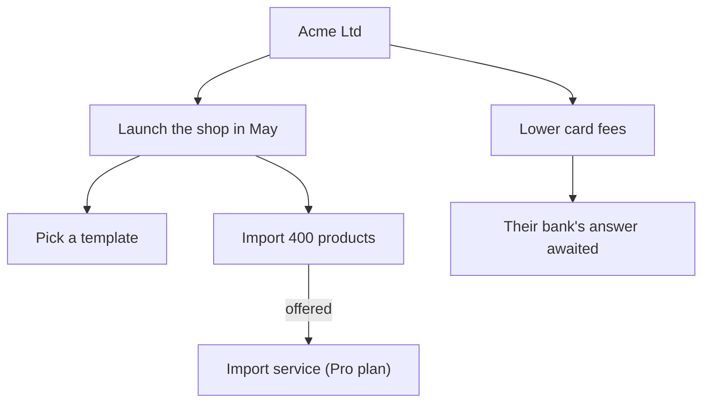

# The client map (P135, P136)

One Mermaid diagram per client: the top-level picture of what the client wants, what is still open and what we did. The agent
redraws it after each draft (Mail or a messenger), after an owner-sent reply it sees and after a message with a new fact; the Hub
keeps it with its evidence, shows it, and copies it to the client's Notion page.

## Where it lives

- **The Hub is the truth.** `clients.map` holds the current Mermaid text, `clients.map_updated_at` when it was drawn, and
  `client_maps` every version (migration 0036), so a redraw never loses the previous map. Each version also keeps its `sources`
  (node id to the messages or days it rests on) and its `reasons` (node id to why that redraw removed or renamed it), migration
  0037; a version drawn before P136 has neither. Only a client the Hub recorded (after a
  draft, a kept message or a linked chat) has a map: the database is not a client directory (decision 0009).
- **Who writes it:** the agent, through the hub MCP tool `client_map` (the whole new text, with the client's id or address).
  **When** (P136 verdict 2): after a draft, after a reply the owner sent that it sees in Mail or a chat, and after an inbound
  message with a new fact (a decision, price, date, refusal); never for spam, "thanks" or "ok". **How** (verdict 3): `client_show`
  first, then the whole map redrawn by the checklist of `skills/triage-mail/references/client-map.md` (level 1 the client's
  outcomes in their words, every leaf a concrete action or answer with a state, `waiting` names who is awaited, branches done for
  30+ days collapse into one Done node). The tool answers the **diff** against the version before (added, removed, renamed, state
  changes) and refuses a removed or renamed node without a reason in `why` (`map_why_missing`; verdict 4). Writing a map sends
  nothing. **Weekly** (verdict 6): the skill `review-maps` ("review the maps of X") redraws every client active in the last 30
  days whose map is older than 7 days or missing, from its whole history (`maps_due` lists them); draft-only, it sends nothing.
- **Where the owner sees it** (P136 verdict 7): Mail and Messengers, under the name in the conversation header, "Map · 3 open · 1
  waiting" (a button that opens the sheet); no map: "Draw map", which puts a request into the dock terminal for him to finish. The
  wide side sheet: the drawing, "Updated <when>", the change from the previous version (added, removed struck through, state
  changes) with the `why` lines under it, the legend of the four states, the map as an outline (the states in words; a node's
  button highlights its source messages in the thread), Copy Mermaid, Open in Notion, and **Correct**, which puts "redraw the map
  of <client>: " into the dock terminal for him to finish (never Enter, never a send). A lead's card has none: a lead has no map
  until it is a client. **Overview** shows "Where we are stuck" per project: the clients whose map has a `blocked` node or a
  `waiting` one for 7 days or more (since the oldest version of the unbroken run), most stuck first
  (`GET /api/projects/:slug/client-maps/stuck`).
- **Notion:** the client's Clients page gets one section, a heading "Client map" and one `mermaid` code block under it, which
  the Hub updates in place on every new version (the rest of the page is never touched; the integration cannot delete, so the
  block is edited, not replaced). The date property **Map updated** lets a view sort by it. There is no text property for the
  source (2,000 UTF-16 units per rich text item, and Notion would show raw code); the code block is split into items of at most
  2,000 units. `hub install` adds **Map updated** (step `notion.client-map`); Notion's API cannot create a Status or a
  cross-database formula, and this needs neither. The `%% src` lines stay in the Hub (the Notion copy drops them).
- **Next step** (P136 verdict 5): with each new version the Hub sets the Clients page's text property `Next step` (when the
  database has it as text) from the map: the open leaf whose label holds the nearest date (ISO `YYYY-MM-DD`), else the first
  open leaf, else the first waiting one; so the map and the profile never disagree. The agent keeps it right through the map; it writes `Next step` itself only in a
  run that does not redraw the map, or when the map has no open leaf, and the next map version replaces it
  (`skills/triage-mail/references/profile.md`).

## The shape (what `client_map` accepts)

`@hub/diagram/map` checks the text before it is saved; a refusal (`map_invalid`) names the line and the old map stays. It is a
strict subset of Mermaid's flowchart (Mermaid's own parser needs a DOM and cannot run on the server; `@mermaid-js/parser` has no
flowchart grammar), so what passes is valid Mermaid:

- `flowchart TD` first. Nodes `id[Label]`, `id(Label)`, `id{Label}`, `id([Label])`, `id((Label))`, `id[[Label]]`; a label with
  brackets in quotes (`id["Import (Pro plan)"]`). Edges `a --> b`, `a -.-> b`, `a ==> b`, `a -->|offered| b`. `subgraph id[Label]`
  ... `end` (no nesting). `class a,b done` or `id[...]:::done`. `%%` comments. Nothing else: no `classDef`, `style`, `click`.
- **Root:** the client (company), the one node nothing points at. **Level 1:** their goals or problems, at most 6 open (a branch
  marked `done` does not count). **Below:** sub-problems or questions, at most 4 levels below the client. **Leaves:** what we did
  or offered (a product, an answer, an offer, a price of ours), each with a state class: `open`, `waiting`, `done`, `blocked`.
- **Sources** (P136 verdict 1): every node below the client has one line `%% src <id>: <ref>[, <ref>]` (a Mermaid comment), a ref
  being a Message-ID or `YYYY-MM-DD <channel>` (`2026-11-20 telegram`, `2026-11-21 call`); a node without one is refused
  (`map_invalid: p1b has no source`).
- At most 30 nodes; labels at most 6 words and 60 characters; an edge label only when the relation is not "part of". No address,
  phone number or third party's price. One `subgraph` per channel only when both Mail and messengers carry the matter.
- **Rebuild, not append:** each call is the whole picture as it stands now: merge, rename, mark resolved branches `done`, drop
  what no longer matters. Ids stay stable across redraws (`p1`, `p1a`, `p1a1`) so two versions compare line by line.

Example:

## Code

`packages/diagram` (`./map` the check, the sources, the diff, the outline and the Notion copy; `./map-status` the counts, the stuck
nodes and the next step; `./render` the browser renderer, also Help's scheme),
`packages/db/src/repos/client-maps.ts`, `packages/agent/src/mcp/tools/client-map.ts`, `apps/server/src/mail/client-map-routes.ts`
(`GET /api/projects/:slug/clients/:id/map`, `GET /api/projects/:slug/client-maps/stuck`),
`apps/admin/src/components/conversation/client-map*.tsx`, `apps/admin/src/features/overview/stuck.tsx`,
`packages/notion/src/client-map.ts`, the installer step `notion.client-map`, the skill `skills/review-maps`.
`hub client map <address>` prints the source.

Update this page when the architecture changes.
